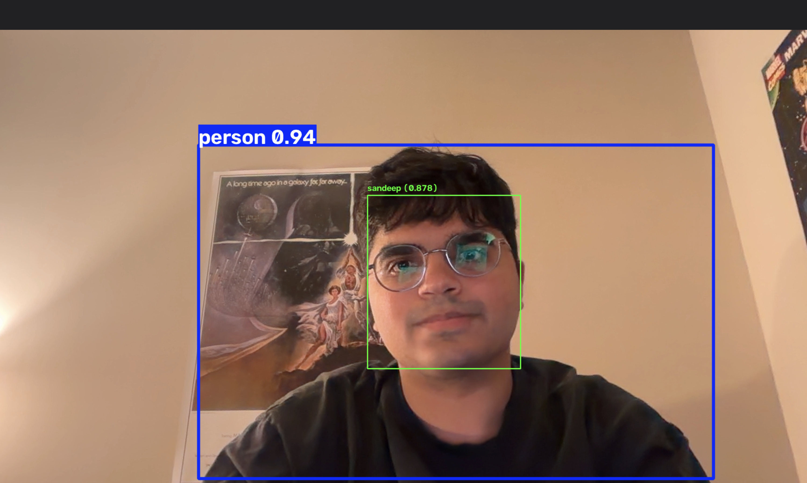

# Raspberry Pi Smart Doorbell

An AI-powered smart doorbell that uses computer vision to detect and recognize people entering an apartment.

This project is my first hands-on experience with pretrained computer vision models. I'm developing and testing the prototype on my MacBook using Python and OpenCV, with plans to deploy it on a Raspberry Pi 5 equipped with the Raspberry Pi AI Camera.



## Project Goals

- **Object Detection:** Detect people and everyday objects in real time using a pretrained YOLO model.
- **Facial Recognition:** Identify familiar visitors using facial embeddings and a local database.
- **Personalized Greetings:** Play a customized chime or greeting when a registered person enters.
- **Entrance Monitoring:** Detect activity around the apartment entrance.
- **Notifications:** Send entrance events and recognition results to authorized users.

## How It Works

1. **Object detection** — Ultralytics YOLO11 runs on each webcam frame and draws bounding boxes for detected objects.
2. **Face detection** — OpenCV's YuNet model locates faces in the frame.
3. **Face embedding** — Each face is aligned and passed through OpenCV's SFace model to produce a 128-dimensional embedding.
4. **Recognition** — The embedding is compared (cosine similarity) against enrolled embeddings stored in a local SQLite database. A match above the threshold is labeled with the person's name; anything else is labeled `UNKNOWN`.

## Tech Stack

- **Language:** Python 3
- **Computer Vision:** OpenCV (YuNet face detector, SFace face recognizer)
- **Object Detection:** Ultralytics YOLO11 (nano / small)
- **Database:** SQLite for enrolled face embeddings
- **Hardware (Planned):** Raspberry Pi 5 + Raspberry Pi AI Camera

## Project Structure

| File | Purpose |
| --- | --- |
| `main.py` | Live camera feed with YOLO detection and face recognition |
| `test_faces.py` | Enrollment tool: capture and save face embeddings for a named person |
| `face_identifier.py` | `FaceIdentifier` class wrapping YuNet detection and SFace embeddings |
| `database.py` | `FaceDatabase` class for storing and loading embeddings in SQLite |
| `models/` | YuNet and SFace ONNX models (not committed, see setup) |
| `faces.db` | Local SQLite database of enrolled faces (not committed) |

## Current Progress

- [x] Configure Python development environment
- [x] Implement live webcam capture with OpenCV
- [x] Integrate pretrained YOLO object detection
- [x] Display real-time bounding boxes and confidence scores
- [x] Implement facial detection and recognition
- [x] Store registered facial embeddings locally
- [x] Build an enrollment tool for registering new faces
- [ ] Use YOLO person detection to gate face recognition
- [ ] Integrate Raspberry Pi AI Camera
- [ ] Implement personalized audio greetings
- [ ] Add entrance event notifications

## Setup

Create a virtual environment and install dependencies:

```bash
python3 -m venv .venv
source .venv/bin/activate
pip install -r requirements.txt
```

Download the face models into a `models/` directory:

```bash
mkdir -p models
curl -L -o models/yunet.onnx https://github.com/opencv/opencv_zoo/raw/main/models/face_detection_yunet/face_detection_yunet_2023mar.onnx
curl -L -o models/sface.onnx https://github.com/opencv/opencv_zoo/raw/main/models/face_recognition_sface/face_recognition_sface_2021dec.onnx
```

The YOLO weights (`yolo11n.pt`, `yolo11s.pt`) are downloaded automatically by Ultralytics on first run.

## Usage

### Enroll a face

```bash
python test_faces.py
```

- Press `N`, then type a name in the terminal.
- With exactly one face in frame, press `E` to save an embedding. Press it several times at different angles for better recognition.
- Press `Q` to quit.

### Run the doorbell

```bash
python main.py
```

Recognized faces are drawn in green with a confidence score; unrecognized faces are drawn in red. Press `Q` to close the camera feed.

## Project Status

**In Development** — Object detection and facial recognition work on macOS. Next up is tying the two together and moving to Raspberry Pi hardware.

## Privacy

The project is intended for a private apartment entrance. Facial recognition is limited to enrolled, consenting individuals. All embeddings are stored locally in SQLite and never leave the device.
