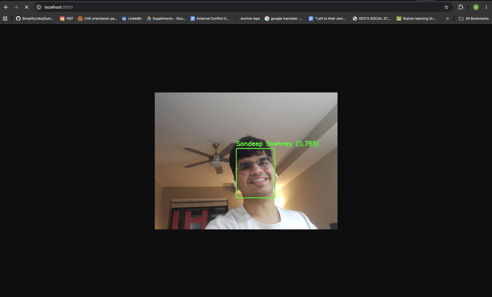

# Raspberry Pi Smart Doorbell

An AI-powered smart doorbell that uses computer vision to detect and recognize people entering an apartment.

This project is my first hands-on experience with pretrained computer vision models. I prototyped it on my MacBook using Python and OpenCV, and it now runs on a Raspberry Pi 5 with the Camera Module 3 Wide, streaming live recognition results to my laptop over a Tailscale VPN.



*Live MJPEG stream from the Pi, viewed on my MacBook at `localhost:8000`, recognizing me in real time.*

## Project Goals

- **Object Detection:** Detect people and everyday objects in real time using a pretrained YOLO model.
- **Facial Recognition:** Identify familiar visitors using facial embeddings and a local database.
- **Personalized Greetings:** Play a customized chime or greeting through the I2C speaker when a registered person enters.
- **Door State Detection:** Classify whether the door is open or closed so recognition only runs when someone is actually entering.
- **Entrance Monitoring:** Detect activity around the apartment entrance.
- **Notifications:** Send entrance events and recognition results to authorized users.

## How It Works

1. **Capture** — On the Pi, `picamera2` pulls 640x480 RGB frames from the Camera Module 3 Wide. On the Mac, OpenCV reads from the built-in webcam.
2. **Face detection** — OpenCV's YuNet model locates faces in the frame.
3. **Face embedding** — Each face is aligned and passed through OpenCV's SFace model to produce a 128-dimensional embedding.
4. **Recognition** — The embedding is compared (cosine similarity) against enrolled embeddings stored in a local SQLite database. A match above the threshold is labeled with the person's name; anything else is labeled `UNKNOWN`.
5. **Streaming** — The annotated frames are JPEG-encoded and served as an MJPEG stream from a tiny Python HTTP server on the Pi, so any browser can watch the live feed.
6. **Object detection (Mac prototype)** — Ultralytics YOLO11 also runs on each frame and draws bounding boxes for detected objects. On the Pi this is kept in a separate script because it is too slow on the CPU to run alongside recognition.

## Hardware

- **Raspberry Pi 5**
- **Raspberry Pi Camera Module 3 Wide** — wide field of view to cover the whole entrance
- **I2C speaker** — for playing chimes and greetings (not wired into the code yet)
- **MacBook** — development machine and stream viewer

## Tech Stack

- **Language:** Python 3
- **Camera:** `picamera2` on the Pi, OpenCV `VideoCapture` on the Mac
- **Computer Vision:** OpenCV (YuNet face detector, SFace face recognizer)
- **Object Detection:** Ultralytics YOLO11 (nano / small)
- **Database:** SQLite for enrolled face embeddings
- **Streaming:** MJPEG over `http.server`, viewed in a browser
- **Networking:** Tailscale VPN between the Pi and MacBook

## Networking: Tailscale

My apartment's Wi-Fi uses client isolation, so devices on the network cannot talk to each other directly. That means I cannot SSH into the Pi or open its stream over the local network.

To get around this, both the Pi and my MacBook are on a [Tailscale](https://tailscale.com/) tailnet. Tailscale builds an encrypted WireGuard tunnel between the two machines that routes around the isolation, so the Pi is reachable at its Tailscale IP (or MagicDNS name) from anywhere.

The stream server binds to `127.0.0.1:8000` on the Pi, so it is never exposed to the network. I connect over SSH (via Tailscale) with VS Code, which forwards port 8000 to my laptop. Opening `http://localhost:8000` in a browser on the Mac then shows the live recognition feed, as in the screenshot above.

## Project Structure

| File | Purpose |
| --- | --- |
| `camera_stream.py` | **Pi:** live face recognition stream served over HTTP on port 8000 |
| `camera_stream_yolo_backup.py` | **Pi:** YOLO11 object-detection stream (kept separate for performance) |
| `camera_stream_backup.py` | **Pi:** bare camera stream with no inference, useful for checking the camera |
| `main.py` | **Mac:** live webcam feed with YOLO detection and face recognition |
| `test_faces.py` | **Mac:** enrollment tool to capture and save face embeddings for a named person |
| `face_identifier.py` | `FaceIdentifier` class wrapping YuNet detection and SFace embeddings |
| `database.py` | `FaceDatabase` class for storing and loading embeddings in SQLite |
| `models/` | YuNet and SFace ONNX models (not committed, see setup) |
| `faces.db` | Local SQLite database of enrolled faces (not committed) |

## Current Progress

- [x] Configure Python development environment
- [x] Implement live webcam capture with OpenCV
- [x] Integrate pretrained YOLO object detection
- [x] Display real-time bounding boxes and confidence scores
- [x] Implement facial detection and recognition
- [x] Store registered facial embeddings locally
- [x] Build an enrollment tool for registering new faces
- [x] Set up Tailscale to reach the Pi through client-isolated Wi-Fi
- [x] Run face recognition on the Raspberry Pi with the Camera Module 3 Wide
- [x] Stream live annotated video from the Pi to a browser
- [ ] Door open/closed state classification
- [ ] Use door state and person detection to gate face recognition
- [ ] Play personalized audio greetings through the I2C speaker
- [ ] Add entrance event notifications
- [ ] Run the stream as a service so it starts on boot

## Setup

### A note on CUDA (read this first)

Everything in this project runs on the CPU. The one dependency to be careful with is `ultralytics`, which depends on `torch`. On Linux, the default PyPI build of `torch` pulls in several gigabytes of NVIDIA CUDA libraries (cuDNN, NCCL and friends) that are useless on a Raspberry Pi and will fill the SD card.

`requirements.txt` avoids this by pinning `torch` and `torchvision` to PyTorch's CPU-only wheel index. Always install with `pip install -r requirements.txt`. Do **not** run a bare `pip install ultralytics` on Linux, or you will get the CUDA build.

If you have already installed the CUDA build by accident, remove it and reinstall from the requirements file:

```bash
pip uninstall -y torch torchvision $(pip list 2>/dev/null | awk '/^nvidia-/ {print $1}')
pip install -r requirements.txt
```

### Mac (development)

Create a virtual environment and install dependencies:

```bash
python3 -m venv .venv
source .venv/bin/activate
pip install -r requirements.txt
```

### Raspberry Pi

`picamera2` is installed through apt on Raspberry Pi OS, so the venv needs access to system packages:

```bash
sudo apt install -y python3-picamera2
python3 -m venv --system-site-packages .venv
source .venv/bin/activate
pip install -r requirements.txt
```

The requirements file installs the CPU-only `torch` wheel on Linux, so this should stay well under a gigabyte. If you see `nvidia-cudnn` or similar scrolling past, stop and check the note on CUDA above.

Install Tailscale on the Pi and the Mac, sign both into the same tailnet, then SSH to the Pi using its Tailscale hostname.

### Face models (both)

Download the face models into a `models/` directory:

```bash
mkdir -p models
curl -L -o models/yunet.onnx https://github.com/opencv/opencv_zoo/raw/main/models/face_detection_yunet/face_detection_yunet_2023mar.onnx
curl -L -o models/sface.onnx https://github.com/opencv/opencv_zoo/raw/main/models/face_recognition_sface/face_recognition_sface_2021dec.onnx
```

The YOLO weights (`yolo11n.pt`, `yolo11s.pt`) are downloaded automatically by Ultralytics on first run.

## Usage

### Enroll a face (Mac)

```bash
python test_faces.py
```

- Press `N`, then type a name in the terminal.
- With exactly one face in frame, press `E` to save an embedding. Press it several times at different angles for better recognition.
- Press `Q` to quit.

Copy the resulting `faces.db` to the Pi (for example with `scp` over Tailscale) so it recognizes the same people.

### Run the doorbell (Mac)

```bash
python main.py
```

Recognized faces are drawn in green with a confidence score; unrecognized faces are drawn in red. Press `Q` to close the camera feed.

### Run the live stream (Pi)

```bash
python camera_stream.py
```

With port 8000 forwarded over SSH, open `http://localhost:8000` in a browser on your laptop to watch the feed. Press `Ctrl+C` to stop.

## Project Status

**In Development** — Face recognition runs on the Raspberry Pi and streams to my laptop over Tailscale. Next up is detecting whether the door is open so recognition and greetings only fire when someone actually comes in.

## Privacy

The project is intended for a private apartment entrance. Facial recognition is limited to enrolled, consenting individuals. All embeddings are stored locally in SQLite and never leave the device. The video stream is bound to localhost on the Pi and only reachable through an authenticated Tailscale connection.
